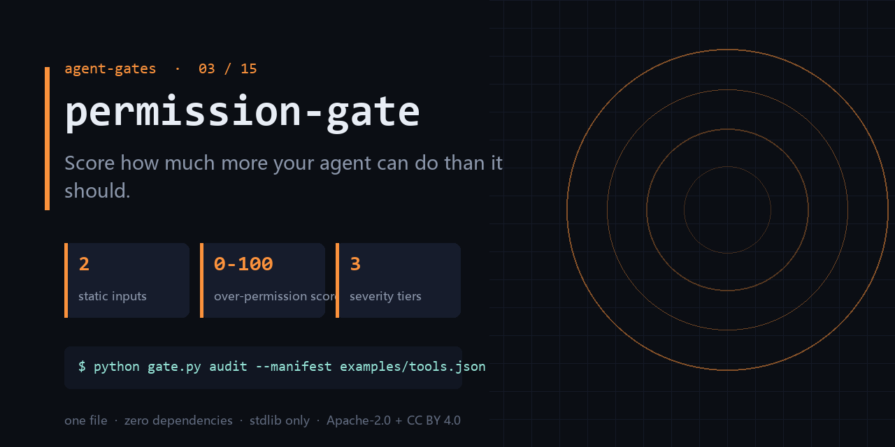

<div align="center">

</div>

<h1 align="center">permission-gate</h1>

<p align="center"><b>Score how much more your agent can do than it should.</b><br><sub>one file · zero dependencies · stdlib only</sub></p>

<p align="center"><a href="https://github.com/chenhz01/permission-gate/actions/workflows/gate.yml"></a>   </p>

---

## The failure this catches

- An agent that only answers doc questions holds write_file, shell, and outbound network.
- Nobody audited the tool list; three months later six high-risk ops had quietly appeared.
- Security asks for the agent's least-privilege scope and the answer is 'roughly these'.

One command, on a file you already have:

```bash
python gate.py audit --manifest examples/tools.json --policy examples/policy.json --min-score 80
```

<details>
<summary><b>Real output</b> — produced by the bundled <code>examples/</code>, not a mock-up</summary>

```text
permission-gate report
  pairs: 9  allowed: 2  denied: 1  unreviewed: 6
  surface: 66.7%  risk-weighted: 80.0%  score: 20.0  grade: D
  - decide: allow or deny 'shell:exec' (weight 4)
  - decide: allow or deny 'fs:write' (weight 3)
  - decide: allow or deny 'http:network' (weight 3)
  - decide: allow or deny 'mail:send' (weight 2)
  - decide: allow or deny 'db:query' (weight 2)
```

</details>

## What it does

- Computes an over-permission score from two static files: tool manifest and policy.
- Flags each gap with severity, so you can fix the HIGH ones today.
- Runs in CI as a gate — permission drift fails the build instead of the audit.

## What it does **not** do

- It does not observe runtime calls; a perfectly scoped policy can still be abused.
- It does not know your business role semantics — you declare what the role needs.
- It is not a sandbox. Pair it with one.

Being explicit here is cheaper than a wrong expectation later.

## Exit codes

`0` = clean, `1` = findings. Gate your pipeline on `$?`.

## Install

```bash
git clone https://github.com/chenhz01/permission-gate
cd permission-gate
python gate.py --help
```

Python 3.9+. Nothing to `pip install` — stdlib only.

## Use it in CI

```yaml
- name: permission-gate
  run: python gate.py audit --manifest examples/tools.json --policy examples/policy.json --min-score 80
```

`action.yml` is included, so you can also reference the repo directly as a composite action.

## 中文速览

**权限门** — 量化 Agent「能做的事」比「该做的事」多出多少。

- 一个只负责查文档的 Agent，手里握着 write_file、shell 和网络出口。
- 工具清单没人审，三个月后多了 6 个高危操作，没人记得是谁加的。
- 安全评审问「这个 Agent 最小权限是什么」，你只能回答「大概这些吧」。

一行命令：`python gate.py audit --manifest examples/tools.json --policy examples/policy.json --min-score 80`

边界：It does not observe runtime calls; a perfectly scoped policy can still be abused.

## The gates

| # | gate | what it stops |
|---|---|---|
| 02 | **[loop-gate](https://github.com/chenhz01/loop-gate)** | Find where your agent looped, before it burns another run |
| 03 | **permission-gate** ← you are here | Score how much more your agent can do than it should |
| 04 | **[context-gate](https://github.com/chenhz01/context-gate)** | Measure what truncation deletes, before the model starts guessing |
| 05 | **[instruction-gate](https://github.com/chenhz01/instruction-gate)** | Two of your instructions contradict each other. This finds them |
| 06 | **[output-gate](https://github.com/chenhz01/output-gate)** | Before AI-written text ships, run the four checks it always fails |
| 07 | **[memory-expiry-gate](https://github.com/chenhz01/memory-expiry-gate)** | Give every memory a TTL, then prove the expiry semantics actually hold |
| 08 | **[drift-gate](https://github.com/chenhz01/drift-gate)** | When embeddings drift, retrieval quietly rots. Fingerprint it |
| 09 | **[price-gate](https://github.com/chenhz01/price-gate)** | Your cost model is only as good as the price table under it |
| 10 | **[complexity-ceiling](https://github.com/chenhz01/complexity-ceiling)** | Per-file complexity budgets that fail the build instead of the reviewer |
| 11 | **[deadcode-gate](https://github.com/chenhz01/deadcode-gate)** | Quantify how much of the repo is dead, instead of guessing |
| 12 | **[docrot-gate](https://github.com/chenhz01/docrot-gate)** | Docs don't die at once. They rot one stale command at a time |
| 13 | **[leak-gate](https://github.com/chenhz01/leak-gate)** | Scan for internal detail before the doc leaves the building |
| 14 | **[backup-gate](https://github.com/chenhz01/backup-gate)** | A backup you have never verified is a rumor |
| 15 | **[trail-gate](https://github.com/chenhz01/trail-gate)** | Hash-chained agent audit trail — and it verifies its own chain |

## License

- Code: **Apache-2.0** — see [LICENSE](LICENSE)
- Docs and example data: **CC BY 4.0** — see [LICENSE-SPEC](LICENSE-SPEC)

Attribution required when you redistribute the documentation; code can be used commercially
without a separate agreement. See [NOTICE](NOTICE).
